# LYRA

<p align="center">
  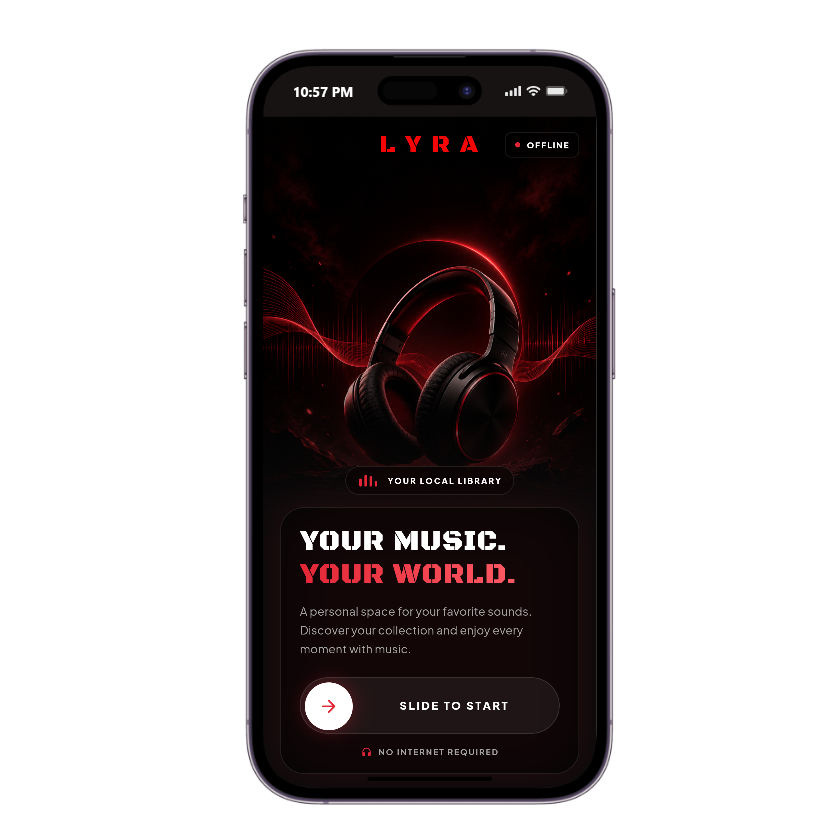
</p>

<h3 align="center">YOUR MUSIC. YOUR WORLD.</h3>

<p align="center">
  A minimal, offline music player built with Flutter.
  <br>
  Designed for music. Made for simplicity.
</p>

<p align="center">
  
  
  
  
</p>

---

## About LYRA

**LYRA** is a personal offline music player developed with Flutter and Dart.

It is designed to provide a clean, modern, and focused music-listening experience using locally bundled MP3 files.

No internet connection. No streaming service. Just your music.

## App Preview

<p align="center">
  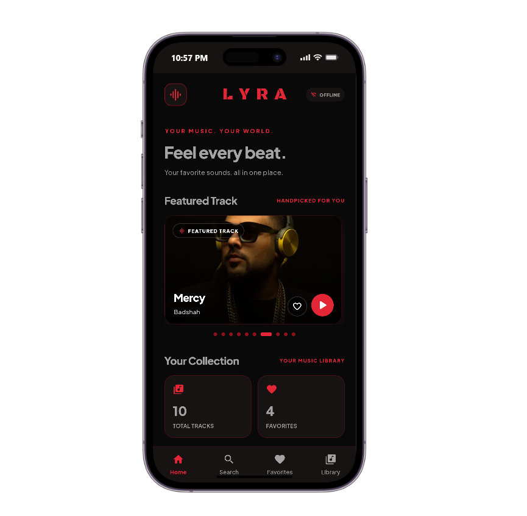
  &nbsp;&nbsp;
  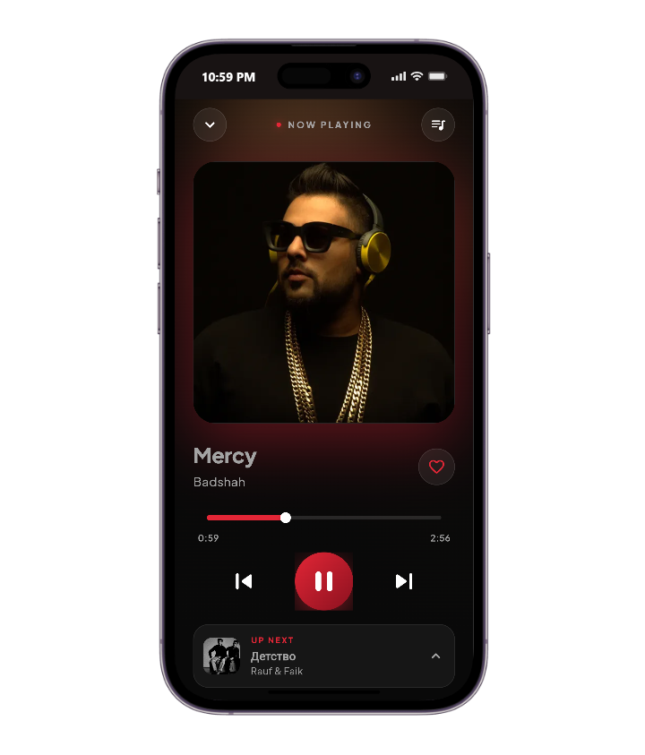
</p>

<p align="center">
  <sub>HOME SCREEN</sub>
  &nbsp;&nbsp;&nbsp;&nbsp;&nbsp;&nbsp;&nbsp;&nbsp;
  <sub>MUSIC PLAYER</sub>
</p>

<p align="center">
  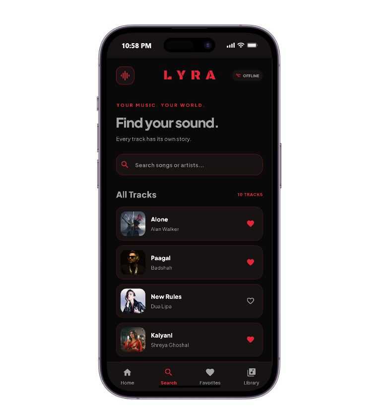
  &nbsp;&nbsp;
  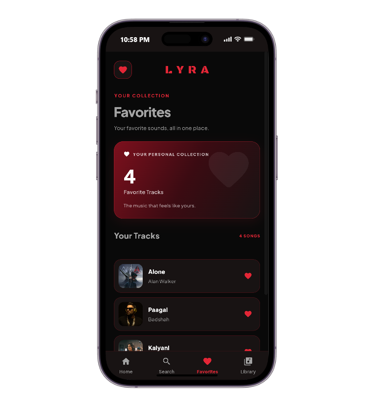
</p>

<p align="center">
  <sub>SEARCH</sub>
  &nbsp;&nbsp;&nbsp;&nbsp;&nbsp;&nbsp;&nbsp;&nbsp;&nbsp;&nbsp;
  <sub>FAVORITES</sub>
</p>

<p align="center">
  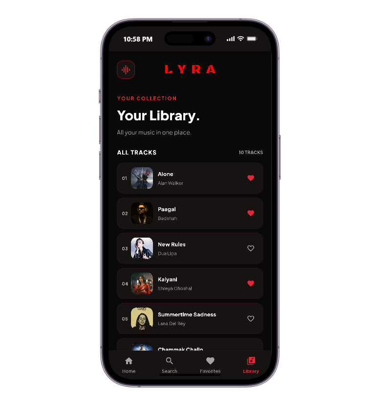
  &nbsp;&nbsp;
  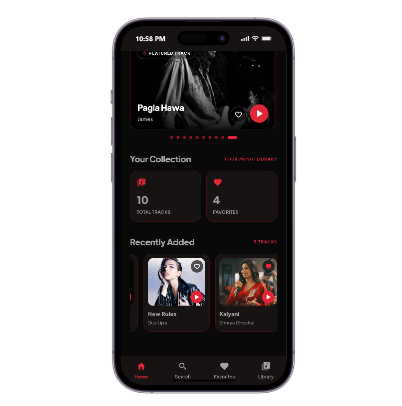
</p>

<p align="center">
  <sub>LIBRARY</sub>
  &nbsp;&nbsp;&nbsp;&nbsp;&nbsp;&nbsp;&nbsp;&nbsp;&nbsp;&nbsp;
  <sub>HOME VIEW</sub>
</p>

### More Player Views

<p align="center">
  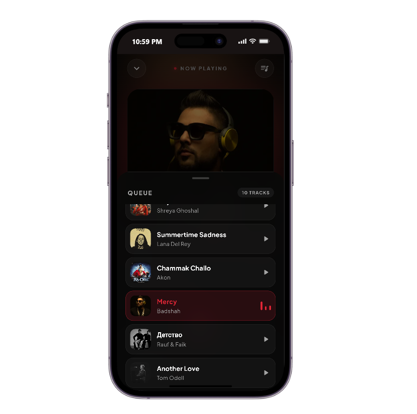
</p>

---

## Features

| Feature | Description |
|---|---|
| Offline Playback | Play bundled MP3 files without internet |
| Music Controls | Play, pause, next and previous |
| Seek Control | Navigate through a song |
| Search | Find songs by title or artist |
| Favorites | Save and remove favorite songs |
| Local Storage | Keep favorites after restarting the app |
| Music Library | Browse the available music collection |
| Album Artwork | Display artwork for each song |

## Album Collection

<p align="center">
  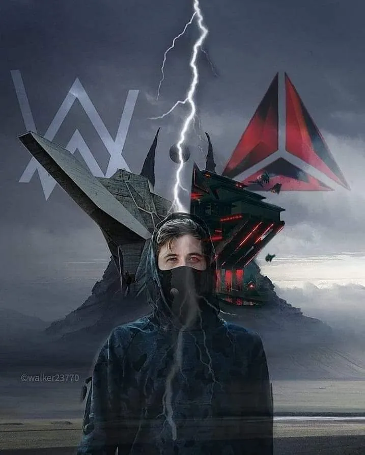
  
  
  
  
</p>

<p align="center">
  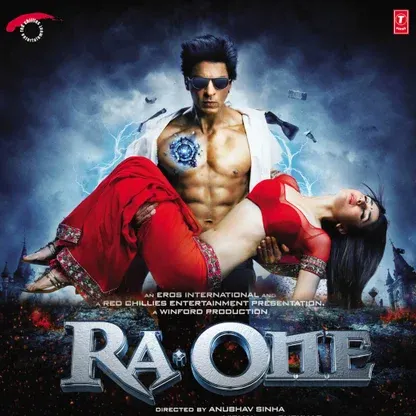
  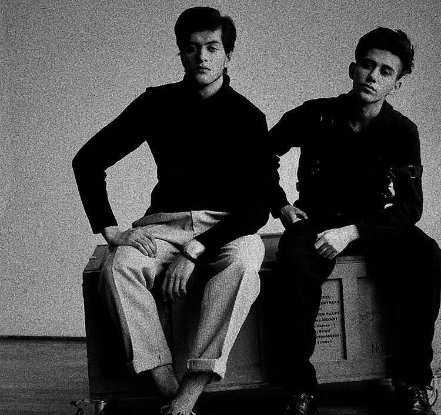
  
  
</p>

<sub>Album artwork used in the LYRA music collection.</sub>

## Tech Stack

| Technology | Purpose |
|---|---|
| Flutter | Cross-platform UI framework |
| Dart | Application development |
| flutter_bloc | State management |
| just_audio | Audio playback |
| shared_preferences | Local favorites storage |

## Getting Started

### Requirements

- Flutter SDK
- Dart SDK
- Android Studio or VS Code
- Git

### Installation

**1. Clone the repository**

```bash
git clone https://github.com/MUfoysal/lyra.git
```

**2. Open the project directory**

```bash
cd lyra
```

**3. Install dependencies**

```bash
flutter pub get
```

**4. Run the application**

```bash
flutter run
```

## Project Structure

```text
lyra/
├── assets/
│   ├── fonts/
│   ├── images/
│   └── songs/
│
├── lib/
│   ├── core/
│   │   └── theme/
│   ├── cubit/
│   ├── data/
│   ├── screens/
│   ├── services/
│   ├── widgets/
│   └── main.dart
│
├── test/
├── pubspec.yaml
└── README.md
```

## Design Philosophy

LYRA follows a **Crimson Noir** visual direction.

- Dark background for a focused listening experience.
- Crimson red accents for visual identity.
- Custom typography for a distinctive appearance.
- Minimal interface with clear navigation.
- Album-focused music presentation.

## Developer

<p align="center">
  <strong>Mohib Ullah Foysal</strong>
  <br>
  Computer Science & Technology Student
  <br><br>
  <a href="https://github.com/MUfoysal">
    
  </a>
</p>

---

<p align="center">
  <strong>LYRA</strong>
  <br>
  YOUR MUSIC. YOUR WORLD.
  <br><br>
  <sub>Built with Flutter.</sub>
</p>